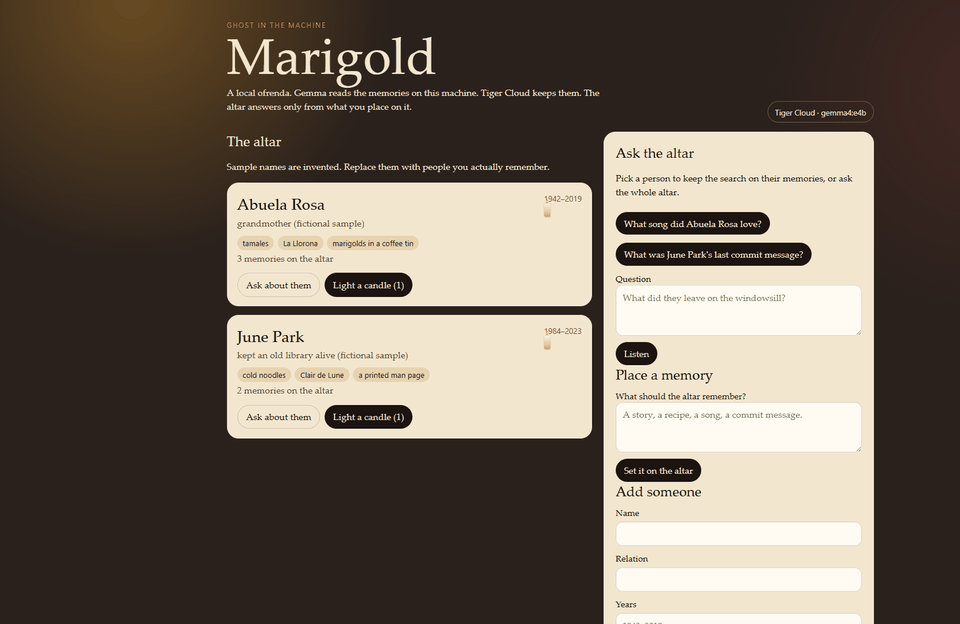
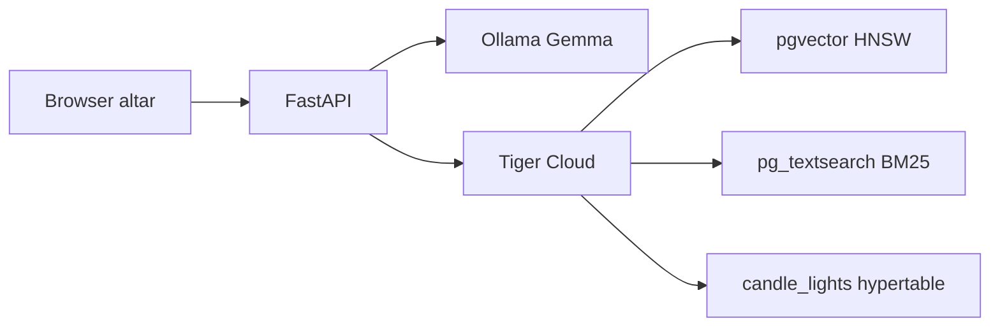

# Marigold



A local ofrenda for [Hacktoberfest Open-Source AI Challenge: Week 4](https://dev.to/challenges/hacktoberfest-week4-2026-10-26) — Ghost in the Machine.

You place people, songs, foods, and stories on an altar. **Gemma**, running in [Ollama](https://ollama.com/) on your machine, embeds those memories and answers questions. **Tiger Cloud** stores the altar: `pgvector` for meaning, `pg_textsearch` BM25 for exact words such as a song title or a commit message, and a Timescale hypertable for every candle that gets lit. Reciprocal rank fusion keeps a literal name from disappearing into a vague semantic neighbor.

The sample altar is fictional. It exists so the page is not empty the first time it opens.

## Why the open pieces matter

Family stories and the small folklore of a codebase are a poor fit for a closed chat API. Marigold's answers are generated from weights you run locally. The model never sees a memory that retrieval did not return, and if nothing matches, the altar says it is quiet instead of inventing a life.

## Prize categories

- **Best Use of Tiger Data** — memories are `halfvec(768)` with an HNSW cosine index, keyword search uses a BM25 index, and the two lists are fused in the app. Candle lights are a hypertable with a continuous aggregate of lights per day.
- **Best Use of Gemma** — `embeddinggemma` embeds documents and queries with EmbeddingGemma's prompt prefixes, and `gemma4:e4b` writes the reply.

## Run it

Python 3.13 and Ollama are required. Pull the models if you do not have them:

```bash
ollama pull gemma4:e4b
ollama pull embeddinggemma
```

Create a virtualenv, then point the app at a Tiger Cloud dev service. The URI includes a password, so it stays in `.env` and out of git.

```bash
python -m venv .venv
.venv\Scripts\activate
pip install -r requirements.txt
copy .env.example .env
tiger db uri YOUR_SERVICE_ID --with-password
```

Put that URI in `DATABASE_URL`, then:

```bash
python -m uvicorn backend.app:app --port 8765
```

Open http://127.0.0.1:8765

On first launch the app creates the schema if the `beloved` table is missing, then seeds the sample altar. That seed calls Ollama once per sample memory.

There is no login. The app is a single-user local altar.

## Layout



## Schema notes

`backend/schema.sql` is the source of truth. Columnstore is on for candle lights and off the memory table, because a vector column cannot live in columnstore. Candles are kept indefinitely. There is no retention policy.

Hybrid search follows the usual split: BM25 and cosine each return up to 20 rows, then reciprocal rank fusion with `k = 60` keeps the top 5. On this Tiger Cloud build, BM25 scoring goes through `sloth_sort.to_bm25query(text, index_name)` and the `<@>` operator, which returns only rows the index considers a match. That is what keeps "commit message" on June's last commit instead of a vaguely similar paragraph. When a person is selected, both queries filter to that person and the vector query sets `hnsw.iterative_scan = relaxed_order` so the filter does not silently starve the result.

## License

MIT
